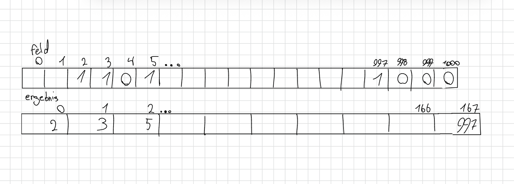

Die Primzahlen von 2 bis 1000 sollen mit dem Sieb des Eratosthenes berechnet werden. Von jeder Primzahl werden alle Vielfachen gestrichen, was am Ende übrig bleibt, sind die Primzahlen.

Das Streichen fängt erst bei p*p an, weil die kleineren Vielfachen schon von kleineren Primzahlen gestrichen wurden. Die äußere Schleife hört auf, wenn p*p größer als 1000 ist.

Das Programm hat zwei Teile: Sieb und Abspeichern. So soll es aufgebaut sein:

```java
// Feld vorbereiten
for (i = 2; i <= 1000; i++) {
    feld[i] = 1;
}

// Sieb
for (p = 2; p * p <= 1000; p++) {
    if (feld[p] == 1) {
        for (i = p; p * i <= 1000; i++) {
            m = p * i;
            feld[m] = 0;
        }
    }
}

// Abspeichern
anzahl = 0;
for (i = 2; i <= 1000; i++) {
    if (feld[i] == 1) {
        ergebnis[anzahl] = i;
        anzahl = anzahl + 1;
    }
}
```

Dafür brauche ich zwei Felder. feld hat 1001 Elemente zu je 1 Byte. Es steht nur 0 (gestrichen) oder 1 (nicht gestrichen) drin. Es sind 1001, weil der Index die Zahl ist und von 0 bis 1000 geht.

ergebnis hat 168 Elemente zu je 2 Byte, weil es bis 1000 168 Primzahlen gibt. Die größte ist 997, die passt nicht in 1 Byte, aber in 2 Byte.



Den Assembler-Code habe ich noch nicht gemacht, weil erstmal nur das Konzept verlangt war. Die Schleifen und if-Abfragen mit Sprungbefehlen muss ich noch üben.
